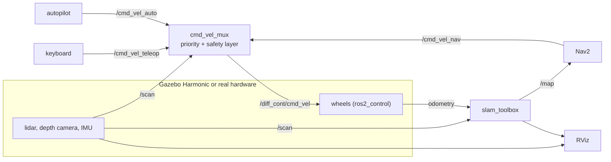

# mobile_robot: one software stack for simulation and hardware

[](https://github.com/helloAi0/Mobile_robot/actions/workflows/ci.yml)


[](LICENSE.md)

A differential-drive robot with lidar, depth camera and IMU on **ROS 2 Jazzy + Gazebo Harmonic**.
The same software runs in simulation and on the real robot: live SLAM mapping, Nav2 goal navigation, an autonomous
obstacle-avoiding mode that stops for walking people, and a safety layer between every driver and the wheels
(e-stop, obstacle guard, fail-safe on sensor loss).

## Highlights

| | |
|---|---|
| **Simulation** | House with a corridor and five rooms, three hinged doors the robot can push, friction patches (wet tile, rubber mat), a ramp, textured props with real physics, walking people. Street world. Sprung drive wheels, swivel caster, noisy lidar / camera / IMU |
| **Mapping** | `slam_toolbox` live map in RViz with loop closure, `save_map.sh` |
| **Navigation** | Nav2: click **2D Goal Pose** in RViz, the robot plans and drives |
| **Autonomy** | `auto:=true`: explores, stops for obstacles and people, turns, continues, backs out when stuck |
| **Safety** | `cmd_vel_mux`: e-stop, front/rear obstacle guard, no lidar = no motion, speed and acceleration limits, command watchdogs |
| **Hardware path** | `hardware.launch.py` (mock or real motor driver), systemd + udev files, Dockerfile |
| **Quality** | 116 tests (safety logic, autopilot, filters, robot description in sim/mock/real, an independent MuJoCo physics check, SDF schema lint), CI, integration test on mock hardware |

## Quick start

**1. Install and build (once)** on Ubuntu 24.04 with [ROS 2 Jazzy](https://docs.ros.org/en/jazzy/Installation/Ubuntu-Install-Debs.html):

```bash
mkdir -p ~/dev_ws/src && cd ~/dev_ws/src
git clone https://github.com/helloAi0/Mobile_robot.git mobile_robot
bash mobile_robot/mobile_robot_bringup/scripts/install_deps.sh        # apt packages
source /opt/ros/jazzy/setup.bash                                      # ALWAYS first, in every terminal
bash ~/dev_ws/src/mobile_robot/build.sh && source ~/dev_ws/install/setup.bash
```

**2. Terminal 1: Gazebo + RViz + live map**

```bash
pkill -f "gz sim"; pkill -f ruby                                      # kill leftovers of an earlier run
ros2 launch mobile_robot_bringup launch_sim.launch.py
```

**3. Terminal 2: drive with the keyboard** (click into this terminal first; the keys only work there)

```bash
ros2 run mobile_robot_bringup teleop_keys.py
```

`i` / `w` forward, `m` / `s` / `,` back, `j` / `l` turn on the spot, `k` stop, `q` / `e` faster / slower, `p` autopilot on/off.
The status line shows who drives and why the robot is limited (`slowing`, `obstacle`, `e-stop`).

**RViz alone** (the launch file already opens it; use this if you closed it):

```bash
ros2 run rviz2 rviz2 -d $(ros2 pkg prefix mobile_robot_bringup)/share/mobile_robot_bringup/rviz/camera.rviz \
     --ros-args -p use_sim_time:=true
```

**Other modes**

```bash
ros2 launch mobile_robot_bringup launch_sim.launch.py auto:=true     # the robot explores by itself
ros2 launch mobile_robot_bringup launch_sim.launch.py nav2:=true     # RViz "2D Goal Pose"
ros2 launch mobile_robot_bringup launch_sim.launch.py world:=street_world.sdf
ros2 run mobile_robot_bringup selftest.py                            # drives ~1 m by itself, every line must say PASS
ros2 run mobile_robot_bringup estop.sh                               # emergency stop   (estop.sh release = go on)
```

Every command with all options: **[docs/COMMANDS.md](docs/COMMANDS.md)**. Presentation script: **[docs/DEMO.md](docs/DEMO.md)**.

## Architecture



Everything except the box on the left is identical in simulation and on the robot. Details, topics and safety layers:
**[docs/ARCHITECTURE.md](docs/ARCHITECTURE.md)**. Going to hardware: **[docs/HARDWARE.md](docs/HARDWARE.md)**.

## What is written here, and what is reused

Reused standard stacks: ROS 2 Jazzy, Gazebo Harmonic, ros2_control, slam_toolbox, Nav2.
Written in this repository:

- `cmd_vel_mux.py`: priority command mux with the safety layer (e-stop, obstacle guard, no-scan fail-safe, speed and acceleration limits).
- `auto_explore.py`: reactive autopilot with stuck recovery. `cloud_filter.py`: floor-removing point cloud filter. `object_detector.py`: lidar objects with distance.
- One URDF for simulation, mock and real hardware, with generated mass properties (full inertia tensors), sprung drive wheels, an offset swivel caster and sensor noise models.
- World generators for the house and street worlds, an importer for textured props, and an SDF linter.
- `metrics_logger.py` (distance, explored area, minimum clearance, stops), `selftest.py`, `diagnose.sh`.
- 116 tests, CI, Docker, systemd/udev deployment files.

## How it is verified

| claim | evidence | where |
|---|---|---|
| the robot drives straight, turns the right way, climbs the 7 degree ramp, stops in 7 cm from full speed, the suspension settles in 0.5 s | independent MuJoCo physics check, 18 measured checks, fails on a deliberately wrong wheel axis | `mobile_robot_description/tools/physics_check.py`, `make physics` |
| the suspension spring is real in Gazebo | read from the Gazebo source: sdformat converts it, the DART backend applies it | [docs/PHYSICS.md](docs/PHYSICS.md) |
| worlds and models are valid SDF | checked against the official sdformat schema; the linter is itself tested on planted errors | `mobile_robot_gazebo/tools/sdf_lint.py` |
| safety layer logic (e-stop, obstacle guard, fail-safe, limits) | unit tests | `mobile_robot_bringup/test/test_mux_safety.py` |
| the whole running system | `selftest.py` drives the robot through the real command path and reports PASS/FAIL per subsystem | [docs/DEMO.md](docs/DEMO.md) |

**Scope, stated plainly:** validated in simulation and by unit tests; **not yet validated on physical hardware**. The physics check uses a
different engine from Gazebo, so it proves the robot description (axes, mass, spring, motors, geometry), not every contact detail of Gazebo.
Run the tests yourself: `make test` (plain Python, no ROS needed).

## Reading RViz (`mobile_robot_bringup/rviz/camera.rviz`)

- **Map**: black = wall, white = free, grey = unknown. **Magenta dots = lidar** (720 beams, 360 degrees, 0.15 to 12 m). Grid squares are 1 m.
- **Camera 3D (floor removed)**: the depth camera as a coloured cloud. **Orange balls + "x.x m"**: objects found in front. Green line: Nav2 path.
- Panels on the left: colour and depth image. Mouse: left-drag orbit, middle-drag pan, scroll zoom. `gui:=false` runs without the Gazebo window.

## Repository layout

```
mobile_robot_description/   urdf/ (xacro: chassis, suspension, caster, sensors, ros2_control), meshes/, tools/ (inertia + mesh generators, MuJoCo physics check)
mobile_robot_gazebo/        worlds/ (house, street, calibration), models/ (textured props, CC BY 3.0), launch/, scripts/, tools/ (world generators, SDF linter)
mobile_robot_bringup/       launch/ (launch_sim, hardware, autonomy), config/, rviz/, scripts/ (mux, autopilot, teleop, metrics, ...), test/
deploy/ (systemd, udev)   docs/   Dockerfile   Makefile   build.sh   .github/workflows/ci.yml
```

## Troubleshooting

- `ros2: command not found` / `Package 'mobile_robot_bringup' not found`: this terminal has no ROS loaded (the `source` lines above).
- The robot does not move: start the keyboard terminal after the launch log says `diff_cont` is active; the status line must show `mux OK`; run `ros2 run mobile_robot_bringup diagnose.sh --move`.
- Robot is stuck: back out with `m`; `obstacle` in the status line means the guard blocks forward motion. In autopilot the robot backs out by itself.
- No map: `ros2 pkg prefix slam_toolbox` must work (`install_deps.sh`).
- More: [docs/DEMO.md](docs/DEMO.md) lists the harmless launch warnings and the problems seen on real runs with their fixes.

License: Apache-2.0 (see [LICENSE.md](LICENSE.md)). Third-party models: [docs/ASSETS.md](docs/ASSETS.md).
