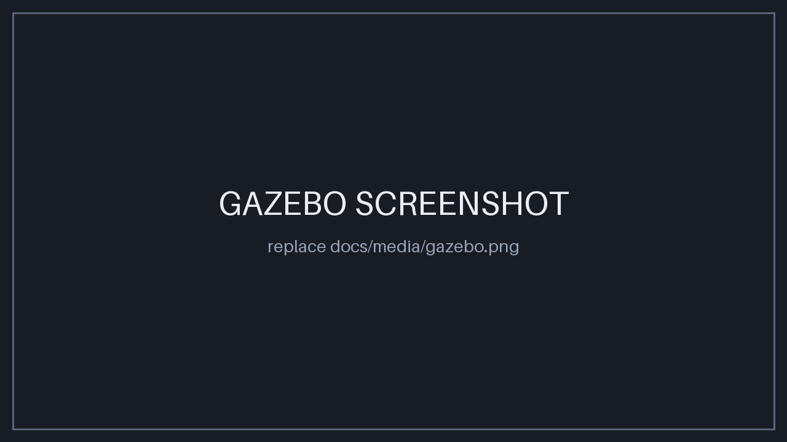
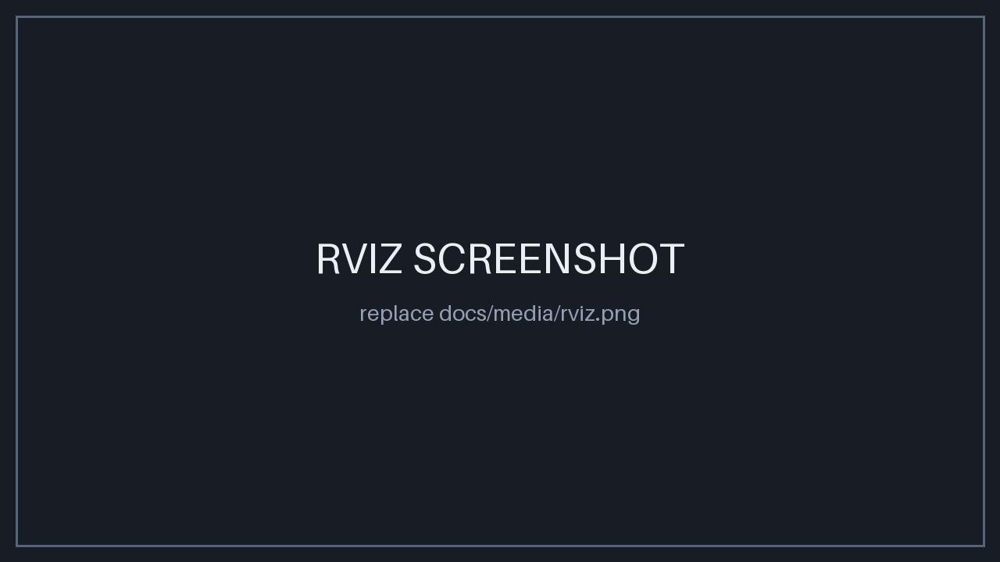
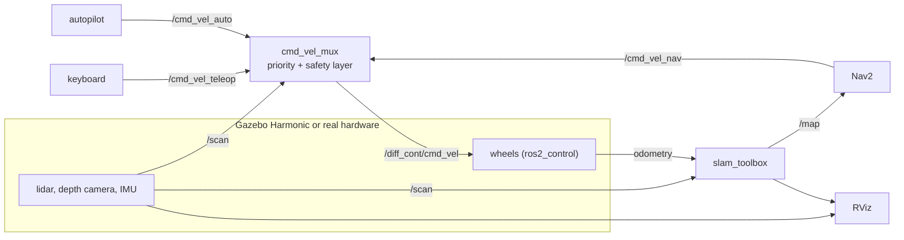
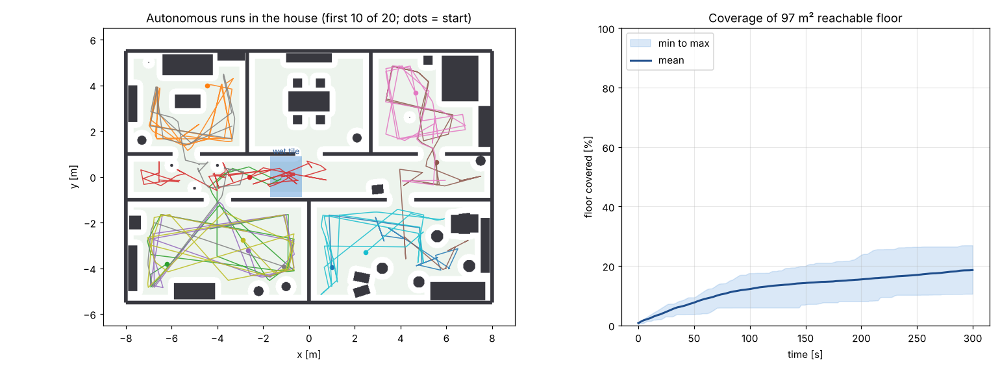

# mobile_robot: autonomous mobile robot software stack (ROS 2 Jazzy, Gazebo Harmonic)

[](https://github.com/helloAi0/Mobile_robot/actions/workflows/ci.yml)


[](LICENSE.md)

A differential-drive robot (2D lidar, depth camera, IMU) with one software stack for **simulation and real hardware**:
live SLAM mapping, Nav2 navigation with a patrol mission, an autonomous obstacle-avoiding mode that stops for walking people,
EKF sensor fusion, rosbag record / replay, and a safety layer between every driver and the wheels.

<p align="center"></p>

<table>
<tr>
<td width="50%"><br><sub><b>Gazebo Harmonic</b>: house with a corridor and five rooms, furniture, textured props, walking people</sub></td>
<td width="50%"><br><sub><b>RViz</b>: live SLAM map, lidar (magenta), depth-camera cloud, detections with distance</sub></td>
</tr>
</table>

## At a glance

| Area | What is here | Details |
|---|---|---|
| Mapping | `slam_toolbox` online async, loop closure, `save_map.sh` | [ARCHITECTURE](docs/ARCHITECTURE.md) |
| Navigation | Nav2 tuned to this robot (footprint, 0.35 m/s cruise, costmaps, doorway-safe inflation) and a nine-waypoint patrol of all rooms | [NAVIGATION](docs/NAVIGATION.md) |
| Autonomy | Reactive explorer: stops for obstacles and people, turns, backs out when stuck | [BENCHMARK](docs/BENCHMARK.md) |
| State estimation | `robot_localization` EKF fusing wheel velocities and IMU gyro; heading error on the slippery tile 12.6° → 1.0° (planar model) | [LOCALIZATION](docs/LOCALIZATION.md) |
| Safety | `cmd_vel_mux`: e-stop, front and rear obstacle guard, no lidar = no motion, speed and acceleration limits, watchdogs | [ARCHITECTURE](docs/ARCHITECTURE.md) |
| Performance | C++ mux, identical to the Python one on 4,800 random cases; scan work 0.63 µs vs 272 µs (sandbox CPU) | [PERFORMANCE](docs/PERFORMANCE.md) |
| Debugging | rosbag record and replay with an RViz layout (red = wheels, green = fused), offline scoring | [RECORD_REPLAY](docs/RECORD_REPLAY.md) |
| Simulation | House (open doorways, wet tile, rubber mat, 7° ramp, textured props with real physics, walking people), street world, sprung drive wheels, swivel caster, noisy lidar / camera / IMU | [PHYSICS](docs/PHYSICS.md) |
| Hardware path | Same launch files with `hardware.launch.py`, mock or real motor driver, systemd + udev, Dockerfile | [HARDWARE](docs/HARDWARE.md) |
| Quality | 234 tests (safety logic, autopilot, filters, robot description in sim / mock / real, independent MuJoCo physics check, SDF schema lint, config checks), CI, integration test on mock hardware | see [How it is verified](#how-it-is-verified) |

## Architecture



Everything except the box on the left is identical in simulation and on the robot. Command priority: **keyboard > Nav2 > autopilot**,
and every command passes the safety layer. Topics, frames and safety layers: **[docs/ARCHITECTURE.md](docs/ARCHITECTURE.md)**.

## Quick start

Ubuntu 24.04 with [ROS 2 Jazzy](https://docs.ros.org/en/jazzy/Installation/Ubuntu-Install-Debs.html). Also works in WSL2 with a Windows GPU driver.

**1. Install and build (once)**

```bash
mkdir -p ~/dev_ws/src && cd ~/dev_ws/src
git clone https://github.com/helloAi0/Mobile_robot.git mobile_robot
bash mobile_robot/mobile_robot_bringup/scripts/install_deps.sh        # apt packages
source /opt/ros/jazzy/setup.bash                                      # first, in every terminal
bash ~/dev_ws/src/mobile_robot/build.sh && source ~/dev_ws/install/setup.bash
```

Every new terminal needs: `source /opt/ros/jazzy/setup.bash && source ~/dev_ws/install/setup.bash` (put both lines in `~/.bashrc`).

**2. Terminal 1: Gazebo + RViz + live map** (wait about 30 s until the house and the robot appear)

```bash
pkill -f "gz sim"; pkill -f ruby                                      # kill leftovers of an earlier run
ros2 launch mobile_robot_bringup launch_sim.launch.py
```

**3. Terminal 2: drive with the keyboard** (click into this terminal first; keys only work there)

```bash
ros2 run mobile_robot_bringup teleop_keys.py
```

`i` / `w` forward, `m` / `s` / `,` back, `j` / `l` turn on the spot, `k` stop, `q` / `e` faster / slower, `p` autopilot on/off.
The status line shows who drives and why the robot is limited (`slowing`, `obstacle`, `e-stop`).

**4. Check that everything works** (Terminal 3, simulation running)

```bash
ros2 run mobile_robot_bringup selftest.py        # every line must say PASS
```

**RViz alone** (the launch already opens it):

```bash
ros2 run rviz2 rviz2 -d $(ros2 pkg prefix mobile_robot_bringup)/share/mobile_robot_bringup/rviz/camera.rviz --ros-args -p use_sim_time:=true
```

### Modes

Start one at a time (they share the simulator). Stop with Ctrl-C and `pkill -f "gz sim"; pkill -f ruby` between runs.

```bash
ros2 launch mobile_robot_bringup launch_sim.launch.py auto:=true                  # explores by itself
ros2 launch mobile_robot_bringup launch_sim.launch.py nav2:=true                  # RViz "2D Goal Pose"
ros2 launch mobile_robot_bringup launch_sim.launch.py nav2:=true patrol:=true     # patrols all rooms
ros2 launch mobile_robot_bringup launch_sim.launch.py ekf:=true                   # wheel odometry + IMU fused
ros2 launch mobile_robot_bringup launch_sim.launch.py mux:=cpp                    # C++ command mux
ros2 launch mobile_robot_bringup launch_sim.launch.py record:=true                # rosbag -> ./bags
ros2 launch mobile_robot_bringup launch_sim.launch.py world:=street_world.sdf
ros2 run mobile_robot_bringup estop.sh                                            # emergency stop (estop.sh release = go on)
```

All commands and options: **[docs/COMMANDS.md](docs/COMMANDS.md)**. Recording script for a demo video: **[docs/DEMO.md](docs/DEMO.md)**.

## Benchmark: how well does it explore, and how safe is it?

The control code of this repository (autopilot, safety layer, lidar degradation) running in a 2D model of the house read from the
Gazebo world file. Method, definitions and what each backend does and does not prove: [docs/BENCHMARK.md](docs/BENCHMARK.md).
**Honest reading:** the robot almost never touches walls or furniture, but people walking head-on are hard for a 0.6 m/s robot,
and a reactive wanderer covers only about a fifth of the floor in 5 minutes. That is what the patrol mission is for.
The Gazebo backend exists but has not been run yet.

<!-- benchmark:start -->
Measured with `tools/benchmark.py --backend sim2d`: 20 runs of 300 simulated seconds, random start and heading (seeds 0..19), 4 walking people, wet tile in the corridor. Reachable floor: 97 m².

| Metric                                                  | Result |
|---------------------------------------------------------|--------|
| Runs                                                    | 20 |
| Coverage of reachable floor                             | 18.6 ± 5.3 % |
| Time to 25 % coverage                                   | 230 ± 20 s (2/20 runs) |
| Time to 50 % coverage                                   | not reached |
| Collisions with walls / furniture per run               | 0.05 ± 0.22 |
| Runs with at least one such collision                   | 1 of 20 |
| Minimum clearance to walls / furniture (worst run)      | 0.00 m |
| Minimum clearance to walls / furniture (mean over runs) | 0.16 ± 0.08 m |
| Contacts with walking people per run                    | 3.25 ± 4.50 |
| Runs with at least one person contact                   | 11 of 20 |
| Closest approach to a person (worst run)                | -0.22 m |
| Distance driven                                         | 52 ± 12 m |
| Stops in front of obstacles                             | 25 ± 7 |
| Run length                                              | 300 ± 0 s |


<!-- benchmark:end -->

## How it is verified

| claim | evidence | where |
|---|---|---|
| the robot drives straight, turns the right way, climbs the 7° ramp, stops in 7 cm from full speed, the suspension settles in 0.5 s | independent MuJoCo physics check, 18 measured checks, fails on a deliberately wrong wheel axis | `mobile_robot_description/tools/physics_check.py`, `make physics` |
| worlds and models are valid SDF | checked against the official sdformat schema; the linter is itself tested on planted errors | `mobile_robot_gazebo/tools/sdf_lint.py` |
| safety layer logic (e-stop, obstacle guard, fail-safe, limits) | unit tests | `mobile_robot_bringup/test/test_mux_safety.py` |
| C++ mux equals the Python mux | 4,800 random golden cases, mutation-checked | `mobile_robot_bringup/test/test_mux_cpp.py` |
| configs load in the ROS parameter parser | test that rejects int / float mixing (a bug found on the first real run) | `mobile_robot_bringup/test/test_config_files.py` |
| the whole running system | `selftest.py` drives the robot through the real command path and reports PASS / FAIL per subsystem | [docs/DEMO.md](docs/DEMO.md) |

**Scope, stated plainly.** Validated in simulation and by unit tests; **not yet validated on physical hardware**. On a real Jazzy +
Gazebo Harmonic install the following has been run: the full simulation, keyboard drive, `selftest.py` (all PASS), `mux:=cpp`,
SLAM, and the Nav2 stack coming up (`bt_navigator` active). Not yet confirmed end to end in live Gazebo: the EKF output, a complete
patrol, bag replay. The benchmark numbers come from the 2D model, and the latency numbers from a CI-class CPU, not from the robot.
The physics check uses a different engine from Gazebo, so it proves the robot description (axes, mass, spring, motors, geometry),
not every contact detail of Gazebo. Run the tests yourself: `make test` (plain Python, no ROS needed).

## Roadmap

- Measure the Gazebo benchmark backend and publish the numbers next to the 2D ones.
- First run on a physical differential-drive base (`hardware.launch.py`, [docs/HARDWARE.md](docs/HARDWARE.md)).
- NVIDIA stack: Isaac ROS (GPU perception such as nvblox / TensorRT detector in place of the lidar-cluster detector), Isaac Sim world,
  deployment on Jetson. **Not started**: listed as direction, not as a feature.

## Reading RViz (`mobile_robot_bringup/rviz/camera.rviz`)

- **Map**: black = wall, white = free, grey = unknown. **Magenta dots = lidar** (720 beams, 360°, 0.15 to 12 m). Grid squares are 1 m.
- **Camera 3D (floor removed)**: the depth camera as a coloured cloud. **Orange balls + "x.x m"**: objects found in front. Green line: Nav2 path.
- Mouse: left-drag orbit, middle-drag pan, scroll zoom. `gui:=false` runs without the Gazebo window.

## What is written here, and what is reused

Reused standard stacks: ROS 2 Jazzy, Gazebo Harmonic, ros2_control, slam_toolbox, Nav2, robot_localization.
Written in this repository:

- `cmd_vel_mux.py` and the C++ `cmd_vel_mux_node`: priority command mux with the safety layer.
- `auto_explore.py` (reactive autopilot with stuck recovery), `patrol.py` (waypoint mission), `cloud_filter.py` (floor-removing point cloud filter), `object_detector.py` (lidar objects with distance).
- One URDF for simulation, mock and real hardware, with generated mass properties (full inertia tensors), sprung drive wheels, an offset swivel caster and sensor noise models.
- World generators for the house and street worlds, an importer for textured props, an SDF linter, the benchmark and EKF evaluation tools, bag tools.
- `selftest.py`, `diagnose.sh`, `metrics_logger.py`; CI, Docker, systemd / udev deployment files.

## Repository layout

```
mobile_robot_description/   urdf/ (xacro: chassis, suspension, caster, sensors, ros2_control), meshes/, tools/ (inertia + mesh generators, MuJoCo physics check)
mobile_robot_gazebo/        worlds/ (house, street, calibration), models/ (textured props, CC BY 3.0), launch/, scripts/, tools/ (world generators, SDF linter)
mobile_robot_bringup/       launch/ (launch_sim, hardware, autonomy), config/, rviz/, scripts/, src/ + include/ (C++ mux), tools/ (benchmark, EKF eval), test/
deploy/ (systemd, udev)   docs/   Dockerfile   Makefile   build.sh   .github/workflows/ci.yml
```

## Troubleshooting

- `ros2: command not found` / `Package 'mobile_robot_bringup' not found`: this terminal has no ROS loaded (the `source` lines above).
- The robot does not move: start the keyboard terminal after the launch log says `diff_cont` is active; the status line must show `mux OK`; run `ros2 run mobile_robot_bringup selftest.py`.
- Forward is blocked: `obstacle` in the status line means the safety guard stopped it (0.38 m). Back out with `m`, turn, go on.
- Nothing visible in RViz right after launch: the simulation needs about 30 s; `Message Filter dropping message` lines at start are normal.
- No map: `ros2 pkg prefix slam_toolbox` must work (`install_deps.sh`).
- More: [docs/DEMO.md](docs/DEMO.md) lists harmless launch warnings and problems seen on real runs with their fixes.

## Changelog

See [CHANGELOG.md](CHANGELOG.md).

License: Apache-2.0 ([LICENSE.md](LICENSE.md)). Third-party models: [docs/ASSETS.md](docs/ASSETS.md).
